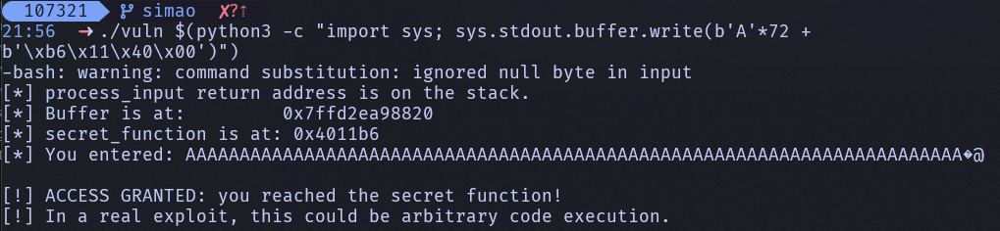

## Exercício 1: Compilação sem mitigações

Comando:

```bash
gcc -o vuln vuln.c -fno-stack-protector -z execstack -no-pie -g
```

Explicação das flags pedidas:


- `-fno-stack-protector`
   Desativa o Stack Canary (proteção da stack).
   Sem esta proteção, um buffer overflow na stack não é detetado automaticamente antes do return da função.

- `-z execstack`
   Marca a stack como executável.
   Isto remove a proteção NX para a stack, permitindo executar código colocado na stack (cenário clássico de exploração).

- `-no-pie`
   Gera o binário sem PIE (Position Independent Executable).
   O executável passa a carregar em endereços fixos (mais previsíveis), facilitando ataques que dependem de conhecer endereços.

- `-g`
   Inclui símbolos de debug no binário.
   Não é uma mitigação de segurança; serve para análise e depuração (por exemplo no gdb), mostrando nomes de funções, variáveis e linhas de código.


## Exercício 2: Execução normal e exploração com GDB

1. 0x7fffffffd920

2. 0x7fffffffd968

3. 0x7fffffffd968 - 0x7fffffffd920 = 0x48
   0x48 = 72 bytes

4. 0x4011b6

## Exercício 3: Desencadear o overflow



## Exercício 4: Efeito das mitigações

- Caso “stack canary ativo”:
  - Compilação usada: gcc -o vuln vuln.c -z execstack -no-pie -g
  - Observação técnica: binário sem PIE (Type EXEC) e com símbolo __stack_chk_fail (canary presente).
  - Resultado do ataque: não funciona.
  - Mensagem observada: stack smashing detected + Aborted (exit 134).
  - Razão: o overflow altera dados protegidos pela canary; na saída da função, a verificação falha e o processo é abortado antes de usar o endereço de retorno corrompido.

- Caso “PIE/ASLR ativo”:
  - Compilação usada: gcc -o vuln vuln.c -fno-stack-protector -z execstack -g
  - Observação técnica: binário PIE (Type DYN), sem canary.
  - Resultado do ataque: não funciona com endereço fixo.
  - Mensagem observada: Segmentation fault (exit 139).
  - Razão: com PIE + ASLR, o endereço de secret_function muda a cada execução. Um payload com retorno fixo (ex: 0x4011b6/0x4011d6) fica inválido e desvia para endereço incorreto, causando crash.

- Caso “todas as mitigações por defeito”:
  - Compilação usada: gcc -o vuln vuln.c -g
  - Observação técnica: PIE ativo (Type DYN), canary presente, stack não executável (GNU_STACK RW, sem E).
  - Resultado do ataque: não funciona.
  - Mensagem observada: stack smashing detected + Aborted (exit 134).
  - Razão: a canary já bloqueia o overwrite de retorno; além disso PIE/ASLR dificulta endereço fixo e NX impediria payload de shellcode em stack.

- Notas importantes do laboratório:
  - A flag do enunciado com --no-pie falhou neste ambiente; a forma que funcionou foi -no-pie.
  - Como o input vem por argumento de linha de comando, bytes nulos não entram no argv; por isso o teste foi feito com overwrite parcial do endereço (bytes baixos), suficiente para demonstrar o efeito das mitigações.

## Exercício 5: Remediação segura

```c
void process_input(char *input) {
    char buffer[64];
    size_t input_len = strlen(input);

    printf("[*] Buffer is at:         %p\n", (void *)buffer);
    printf("[*] secret_function is at: %p\n", (void *)secret_function);

    if (input_len >= sizeof(buffer)) {
        fprintf(stderr, "[!] Input too long: max %zu bytes.\n", sizeof(buffer) - 1);
        return;
    }

    memcpy(buffer, input, input_len + 1);
    printf("[*] You entered: %s\n", buffer);
}
```

- Substituição da cópia insegura:

   A chamada insegura foi removida e substituída por cópia controlada em vuln.c:23, evitando escrita fora dos limites do buffer.

- Verificação explícita de comprimento:
   Foi adicionada verificação de tamanho em vuln.c:18. Se a entrada tiver 64 bytes ou mais, o programa rejeita a entrada e retorna com mensagem de erro, impedindo overflow.

- Compilação com mitigações por defeito:
   Foi compilado com:

   ```bash
   gcc -o vuln vuln.c -g
   ```

## Exercício 6: Compilação e diagnósticos do compilador

1.

   Comando:

   ```bash
   gcc -o fmtvuln fmtvuln.c -g -Wall -Wformat -Wformat-security
   ```

   Aviso produzido pelo compilador:

   ```text
   fmtvuln.c:10:5: warning: format not a string literal and no format arguments [-Wformat-security]
   ```

   O que indica o aviso:
   O GCC está a alertar que `printf(input)` usa dados controlados pelo utilizador como string de formato. Isso indica uma vulnerabilidade de format string (CWE-134), que pode permitir leitura ou escrita indevida de memória.

2.

   Comando:

   ```bash
   gcc -o fmtvuln fmtvuln.c -g
   ```

   Ao compilar sem as flags de aviso e executar `./fmtvuln "Hello, world!"`, o programa comporta-se como esperado: mostra o endereço de secret, imprime Processing input..., ecoa Hello, world! e termina normalmente. Isto confirma que, com uma entrada benigna, não há comportamento anómalo visível.

   Os avisos do compilador são uma forma útil de análise estática porque conseguem detetar automaticamente padrões perigosos, como printf(input), antes da execução. Neste caso, o warning indica que uma string controlada pelo utilizador está a ser usada como string de formato, o que pode levar a vulnerabilidades de format string. No entanto, essa análise não é suficiente por si só: o compilador não conhece todo o contexto da aplicação, pode haver falsos positivos, e um warning não prova que a vulnerabilidade seja explorável em todas as situações. Por isso, estes avisos devem ser complementados com revisão de código e testes.

## Exercício 7: Desencadear a vulnerabilidade

1. No output com `%p` aparecem vários valores em hexadecimal, alguns iguais a endereços e outros a lixo de memória, em vez de apenas a string introduzida. Isso difere da execução normal do Exercício 6, onde o programa só imprimia a mensagem “Hello, world!” e terminava normalmente. Aqui, o `printf` está a revelar conteúdo interno do processo, o que é típico de uma format string vulnerability.

2. Isto acontece porque `printf` é uma função variádica: o número de argumentos não fica guardado de forma que a função o possa validar em tempo de execução. Quem decide quantos valores `printf` vai consumir é a própria string de formato. Quando encontra `%p`, ele avança para o próximo argumento esperado e lê uma palavra da área de argumentos da chamada, que pode acabar por corresponder a dados da stack ou de registos salvos, mesmo que o chamador não tenha passado nenhum argumento correspondente. Em C, não há verificação automática entre os especificadores da string de formato e os argumentos reais.

3. Com `%x`, o output costuma ser semelhante, mas os valores aparecem como inteiros hexadecimais de 32 bits, muitas vezes truncados, sem o formato de ponteiro. Em processo de 64 bits, `%p` é mais apropriado porque lê e imprime um ponteiro completo, preservando o endereço inteiro; `%x` foi pensado para `unsigned int` e pode perder metade da informação relevante.

## Exercício 8: Localizar um valor na stack

O comando:

```bash
./fmtvuln "$(python3 -c "print('%p ' * 30, end='')")"
```

fez com que o programa deixasse de imprimir apenas a mensagem normal e passasse a revelar vários valores internos do processo. No meu output, o programa imprimiu primeiro o endereço da variável local `secret`:

```text
0x7fff535ee2a0
```

Depois, o `printf` interpretou os vários `%p` e mostrou valores da stack/registos, por exemplo:

```text
0x600cbdfc52a0 (nil) 0x7dc93371c5a4 0x7dc933803b20 0x410 (nil) 0x7fff535f0062 0xcafebabe ...
```

O valor sentinela `0xcafebabe` apareceu na 8.ª posição da sequência de `%p`.

Isto demonstra que uma vulnerabilidade de string de formato pode permitir a divulgação de informação interna do processo. Um atacante pode recuperar valores presentes na stack, como variáveis locais, endereços de memória e outros dados sensíveis usados durante a execução do programa.

## Exercício 9: Remediação segura

e de seguida correr:
A correção consiste apenas em trocar a chamada insegura

`printf(input);`

por

`printf("%s", input);`

Isto é seguro porque a string de formato deixa de depender do utilizador e passa a ser fixa. Assim, qualquer sequência como `%p` ou `%x` é tratada como texto normal e não como instrução para o `printf`, pelo que já não há leitura indevida de memória.

Depois de compilar com:

```bash
gcc -o fmtvuln_corrigido fmtvuln_corrigido.c -g -Wall -Wformat -Wformat-security
```

e de seguida correr:

```bash
./fmtvuln_corrigido '%p %p %p %p %p %p %p %p %p %p'
```

output:

```text
[*] Address of secret on stack: 0x7fffd3cb5d10
[*] Processing input...
%p %p %p %p %p %p %p %p %p %p
[*] Normal programme termination.
```

não foi produzido nenhum aviso relacionado com strings de formato.

Isto confirma que os especificadores `%p` foram impressos literalmente e já não houve divulgação de valores da stack.