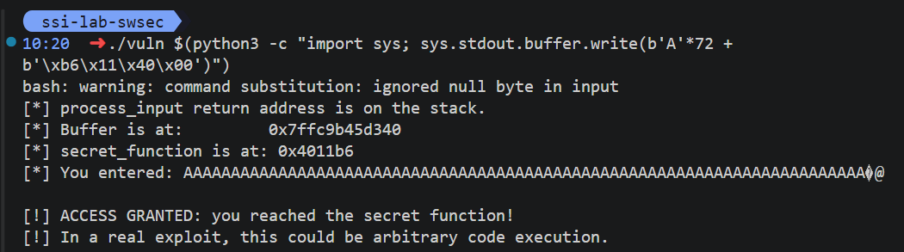

Exercício 1: Compilação sem mitigações

Comando:
gcc -o vuln vuln.c -fno-stack-protector -z execstack -no-pie -g

Explicação das flags pedidas:

-fno-stack-protector
Desativa o Stack Canary (proteção da stack).
Sem esta proteção, um buffer overflow na stack não é detetado automaticamente antes do return da função.

-z execstack
Marca a stack como executável.
Isto remove a proteção NX para a stack, permitindo executar código colocado na stack (cenário clássico de exploração).

-no-pie
Gera o binário sem PIE (Position Independent Executable).
O executável passa a carregar em endereços fixos (mais previsíveis), facilitando ataques que dependem de conhecer endereços.

-g
Inclui símbolos de debug no binário.
Não é uma mitigação de segurança; serve para análise e depuração (por exemplo no gdb), mostrando nomes de funções, variáveis e linhas de código.

Exercício 2: Execução normal e exploração com GDB

1. 0x7fffffffd920

2. 0x7fffffffd968

3. 0x7fffffffd968 - 0x7fffffffd920 = 0x48
   0x48 = 72 bytes

4. 0x4011b6

Exercício 3: Desencadear o overflow

Exercício 4: Efeito das mitigações

- Caso “stack canary ativo”:
   - Compilação usada: gcc -o vuln vuln.c -z execstack -no-pie -g
   - Observação técnica: binário sem PIE (Type EXEC) e com símbolo __stack_chk_fail (canary presente).
   - Resultado do ataque: não funciona.
   - Mensagem observada: stack smashing detected + Aborted (exit 134).
   - Razão: o overflow altera dados protegidos pela canary; na saída da função, a verificação falha e o processo é abortado antes de usar o endereço de retorno corrompido.

- Caso “PIE/ASLR ativo”:
   - Compilação usada: gcc -o vuln vuln.c -fno-stack-protector -z execstack -g
   - Observação técnica: binário PIE (Type DYN), sem canary.
   - Resultado do ataque: não funciona com endereço fixo.
   - Mensagem observada: Segmentation fault (exit 139).
   - Razão: com PIE + ASLR, o endereço de secret_function muda a cada execução. Um payload com retorno fixo (ex: 0x4011b6/0x4011d6) fica inválido e desvia para endereço incorreto, causando crash.

- Caso “todas as mitigações por defeito”:
   - Compilação usada: gcc -o vuln vuln.c -g
   - Observação técnica: PIE ativo (Type DYN), canary presente, stack não executável (GNU_STACK RW, sem E).
   - Resultado do ataque: não funciona.
   - Mensagem observada: stack smashing detected + Aborted (exit 134).
   - Razão: a canary já bloqueia o overwrite de retorno; além disso PIE/ASLR dificulta endereço fixo e NX impediria payload de shellcode em stack.

- Notas importantes do laboratório:
   - A flag do enunciado com --no-pie falhou neste ambiente; a forma que funcionou foi -no-pie.
   - Como o input vem por argumento de linha de comando, bytes nulos não entram no argv; por isso o teste foi feito com overwrite parcial do endereço (bytes baixos), suficiente para demonstrar o efeito das mitigações.

Exercício 5: Remediação segura

void process_input(char *input) {
    char buffer[64];
    size_t input_len = strlen(input);

    printf("[*] Buffer is at:         %p\n", (void *)buffer);
    printf("[*] secret_function is at: %p\n", (void *)secret_function);

    if (input_len >= sizeof(buffer)) {
        fprintf(stderr, "[!] Input too long: max %zu bytes.\n", sizeof(buffer) - 1);
        return;
    }

    memcpy(buffer, input, input_len + 1);
    printf("[*] You entered: %s\n", buffer);
}

- Substituição da cópia insegura:
A chamada insegura foi removida e substituída por cópia controlada em vuln.c:23, evitando escrita fora dos limites do buffer.

- Verificação explícita de comprimento:
Foi adicionada verificação de tamanho em vuln.c:18. Se a entrada tiver 64 bytes ou mais, o programa rejeita a entrada e retorna com mensagem de erro, impedindo overflow.

- Compilação com mitigações por defeito:
Foi compilado com:
gcc -o vuln vuln.c -g