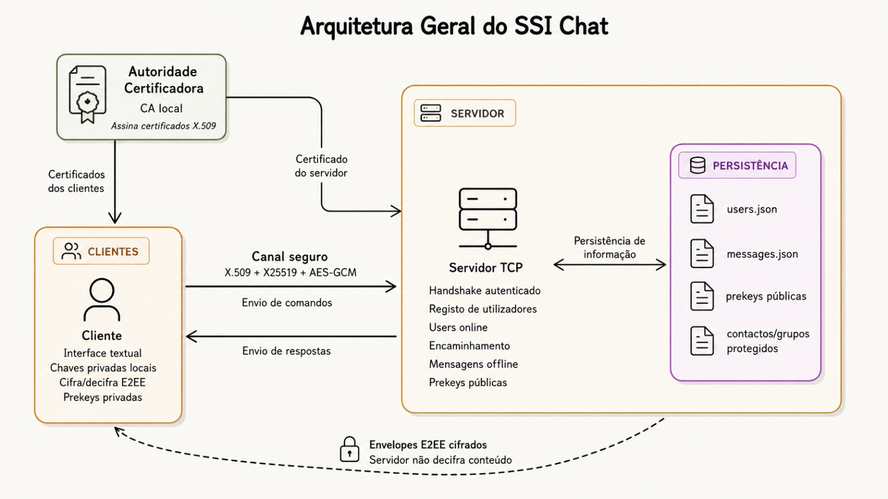
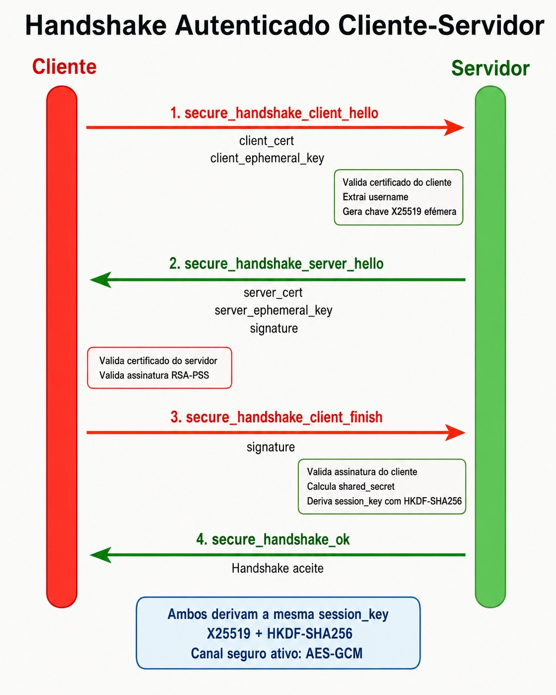

# SSI Chat — Sistema de Conversação Seguro com E2EE

**Repositório:** SSI 25/26  
**Grupo:** A106811 · A107378 · A107321

---

## Índice

1. [Introdução](#introdução)
2. [Arquitetura da Solução](#arquitetura-da-solução)
3. [Identidade e PKI](#identidade-e-pki)
4. [Canal Seguro Cliente-Servidor](#canal-seguro-cliente-servidor)
   - [Handshake](#handshake)
   - [Protocolo de Mensagens](#protocolo-de-mensagens)
5. [E2EE — Mensagens Privadas](#e2ee--mensagens-privadas)
   - [Modo v1 (RSA-OAEP, legado)](#modo-v1-rsa-oaep-legado)
   - [Modo v2 (X25519 efémero)](#modo-v2-x25519-efémero)
6. [Mensagens Offline com Signed Prekeys](#mensagens-offline-com-signed-prekeys)
7. [Sessões Online Efémeras](#sessões-online-efémeras)
8. [Mensagens de Grupo](#mensagens-de-grupo)
9. [Protecção de Contactos e Grupos](#protecção-de-contactos-e-grupos)
10. [Modo PGP-like — Bundles e Ficheiros de Mensagem](#modo-pgp-like--bundles-e-ficheiros-de-mensagem)
11. [Gestão de Chaves](#gestão-de-chaves)
12. [Modelo de Segurança](#modelo-de-segurança)
13. [Testes](#testes)
14. [Limitações e Melhorias Futuras](#limitações-e-melhorias-futuras)
15. [Conclusão](#conclusão)

---

## Introdução

Este projecto consiste no desenvolvimento de um sistema de conversação seguro (chat) com encriptação de ponta a ponta (End-to-End Encryption, E2EE), implementado em Python com a biblioteca `cryptography`. O sistema permite que utilizadores troquem mensagens com garantias estritas de confidencialidade, integridade e autenticidade, assegurando que o conteúdo das comunicações permanece inacessível a terceiros, incluindo o próprio servidor.

A solução implementa um modelo cliente-servidor sobre TCP com autenticação mútua baseada em certificados X.509. Além das funcionalidades base, foram implementadas as seguintes valorizações:

- **PKI local** com Autoridade de Certificação (CA) própria e emissão de certificados X.509;
- **Mensagens offline** via *signed prekeys* X25519;
- **Sessões online efémeras** com forward secrecy por sessão;
- **Mensagens de grupo** com `group_key` AES-256 e rotação de chave;
- **Protecção de contactos e grupos** no servidor (cifrados e assinados);
- **Modo PGP-like** com exportação/importação de bundles públicos e ficheiros de mensagem cifrada, sem dependência do servidor.

---

## Arquitetura da Solução



O sistema é composto por três camadas principais:

**Servidor** (`server/server.py`, `server/command_handlers.py`): aguarda conexões TCP na porta 9000, efectua o handshake de segurança com cada cliente e despacha os comandos recebidos para os respectivos handlers. Gere o registo de utilizadores (`users.json`), o armazenamento de mensagens pendentes (`messages.json`) e o repositório de signed prekeys. Cada cliente é tratado numa thread independente.

**Módulo comum** (`common/`): partilhado por cliente e servidor. Contém a lógica de handshake e de canal seguro (`secure_channel.py`), a validação de certificados e assinaturas RSA (`security.py`), o protocolo de transporte JSON sobre TCP (`protocol.py`) e os utilitários de troca de chaves X25519 (`key_exchange.py`).

**Cliente** (`client/`): implementa a interface de chat em linha de comandos (`chat_ui.py`), o estado local da sessão (`chat_state.py`) e um conjunto modular de handlers para cada tipo de operação: mensagens privadas, sessões online, mensagens offline, grupos, contactos, sincronização, bundles e ficheiros de mensagem.

**Módulo criptográfico** (`crypto/`): contém as primitivas E2EE organizadas por responsabilidade — `e2ee.py` (mensagens privadas), `offline.py` (mensagens com prekeys), `online_sessions.py` (sessões efémeras), `groups.py` (cifra de grupo), `prekeys.py` (geração e verificação de prekeys assinadas), `aad.py` (construção de AAD canónico), `key_derivation.py` (derivação HKDF), `signatures.py` (assinaturas RSA-PSS) e `protected_state.py` (contactos e grupos protegidos).

A persistência servidor usa dois ficheiros JSON com acesso thread-safe via `threading.RLock` e escrita atómica com `os.replace` sobre ficheiro temporário (`storage.py`).

---

## Identidade e PKI

Cada interveniente (utilizador ou servidor) possui dois pares de chaves e um certificado X.509:

- **Chave RSA-2048** (identidade): usada para assinar mensagens, handshake e dados sensíveis. Ficheiros `keys/<username>_private.pem` e `keys/<username>_public.pem`.
- **Chave X25519** (E2EE estática): usada na derivação de chaves para mensagens E2EE v2 e prekeys. Ficheiros `keys/<username>_x25519_private.pem` e `keys/<username>_x25519_public.pem`.
- **Certificado X.509** (`certs/clients/<username>_cert.pem`): emitido e assinado pela CA local (`certs/ca_cert.pem`). O *Common Name* segue o formato `SSI Chat Client - <username>`, o que vincula o certificado ao identificador do utilizador. O servidor tem o seu próprio certificado com CN `SSI Chat Server`.

A **CA local** é a raiz de confiança de todos os intervenientes. A sua chave privada reside em `certs/ca_key.pem` e é usada exclusivamente para emitir certificados. A ferramenta de administração `tools/issue_client_cert.py` automatiza a emissão de certificados de cliente, valida o formato do username (apenas caracteres `[A-Za-z0-9_-]`, impedindo path traversal) e recusa sobreescrever certificados existentes sem a flag `--force`.

No registo, o servidor valida que a chave pública RSA no certificado autenticado corresponde exactamente à chave pública declarada no pedido de registo. A chave X25519 é vinculada à identidade RSA através de uma assinatura RSA-PSS sobre o seu valor em PEM — esta assinatura é verificada no servidor durante o registo e publicada em `users.json` para que outros clientes possam confirmar a autenticidade da chave E2EE.

---

## Canal Seguro Cliente-Servidor

### Handshake

O canal entre cliente e servidor é estabelecido através de um handshake de autenticação mútua com troca de chaves X25519 efémera, conforme implementado em `common/secure_channel.py`.



O protocolo decorre em quatro mensagens:

**1. `client_hello`** — O cliente gera um par X25519 efémero (`generate_ephemeral_keypair`) e envia ao servidor o seu certificado X.509 e a chave pública efémera em bruto (bytes *raw*):

```json
{
  "command": "secure_handshake_client_hello",
  "client_cert": "<PEM do certificado do cliente>",
  "client_ephemeral_key": "<base64 da chave X25519 efémera pública>"
}
```

**2. `server_hello`** — O servidor valida o certificado do cliente (assinatura da CA, validade temporal e formato do CN), gera o seu próprio par X25519 efémero e responde com o seu certificado, a chave pública efémera e uma assinatura RSA-PSS sobre a concatenação `server_ephemeral_pub || client_ephemeral_pub`:

```json
{
  "command": "secure_handshake_server_hello",
  "server_cert": "<PEM do certificado do servidor>",
  "server_ephemeral_key": "<base64 da chave X25519 efémera pública>",
  "signature": "<base64 da assinatura RSA-PSS>"
}
```

**3. `client_finish`** — O cliente valida o certificado do servidor (assinatura da CA e CN `SSI Chat Server`) e a assinatura recebida. Confirma a autenticidade da chave efémera do servidor e responde com a sua própria assinatura RSA-PSS sobre `client_ephemeral_pub || server_ephemeral_pub`:

```json
{
  "command": "secure_handshake_client_finish",
  "signature": "<base64 da assinatura RSA-PSS>"
}
```

**4. `secure_handshake_ok`** — O servidor valida a assinatura do cliente. A autenticação mútua está concluída.

Ambas as partes derivam independentemente a chave de sessão simétrica a partir do segredo ECDH X25519 via **HKDF-SHA256**, com `info = b"ssi-chat-secure-channel-v1" || client_ephemeral_pub_raw || server_ephemeral_pub_raw` (conforme `common/key_exchange.py`). A chave resultante tem 256 bits e é registada no estado do socket para cifrar todas as mensagens subsequentes.

As assinaturas RSA-PSS sobre as chaves efémeras garantem que nenhum atacante de rede pode substituir as chaves durante o handshake, prevenindo ataques *man-in-the-middle* mesmo que o canal físico seja comprometido.

### Protocolo de Mensagens

Após o handshake, todas as mensagens entre cliente e servidor são cifradas com **AES-256-GCM** usando a chave de sessão derivada no handshake (`common/crypto.py`). O formato de transporte é JSON delimitado por newline (`\n`), serializado com `json.dumps` e codificado em UTF-8. O nonce AES-GCM de 96 bits é gerado aleatoriamente por mensagem e prefixado ao ciphertext.

Cada mensagem do cliente inclui pelo menos o campo `"command"`. O servidor responde com pelo menos `"status"` (`"ok"` ou `"error"`) e `"message"`. Os comandos de servidor disponíveis são: `register`, `get_user_key`, `publish_prekeys`, `get_prekey`, `send_message`, `relay_session_envelope`, `fetch_messages`, `ack_messages`, `list_contacts`, `update_contacts`, `list_groups`, `update_groups`, `list_users`.

---

## E2EE — Mensagens Privadas

O conteúdo das mensagens privadas é cifrado pelo cliente antes de ser enviado ao servidor, que apenas armazena e encaminha ciphertext. O servidor nunca tem acesso ao texto em claro. O sistema suporta dois modos, implementados em `crypto/e2ee.py`.


### Modo v1 (RSA-OAEP, legado)

Utilizado quando o destinatário não tem chave X25519 registada. O remetente gera uma chave AES-256 aleatória, cifra o texto com **AES-256-GCM** e cifra a chave AES com **RSA-OAEP-SHA256** (padding OAEP com MGF1-SHA256) sobre a chave pública RSA do destinatário. O ciphertext, nonce e chave cifrada são enviados em base64.

### Modo v2 (X25519 efémero)

Modo preferencial quando o destinatário tem chave X25519 estática registada. O remetente:

1. Gera um par X25519 efémero exclusivo para esta mensagem;
2. Calcula o segredo ECDH entre a chave efémera e a chave X25519 estática do destinatário;
3. Deriva uma chave AES-256 via **HKDF-SHA256** com `info = b"ssi-chat-e2ee-v2" || sender_ephemeral_raw || recipient_static_raw`;
4. Cifra o texto com **AES-256-GCM**, incluindo **AAD canónico** (ver abaixo);
5. Inclui a chave efémera pública no envelope para que o destinatário reproduza o ECDH.

O destinatário replica o ECDH com a sua chave X25519 estática e a chave efémera do remetente, deriva a mesma chave AES e decifra. Como a chave efémera é descartada após cada mensagem, um comprometimento futuro da chave X25519 estática não expõe mensagens passadas cifradas neste modo — característica de **forward secrecy por mensagem**.

**Additional Authenticated Data (AAD):** todas as mensagens incluem AAD canónico construído em `crypto/aad.py`, serializado como JSON com chaves ordenadas:

```json
{"from": "alice", "message_id": "...", "timestamp": "...", "to": "bob"}
```

O AAD é autenticado pelo AES-GCM sem ser cifrado, tornando qualquer adulteração dos metadados detectável. Impede ataques de replay (o `message_id` e o `timestamp` são únicos) e de substituição de mensagem (o `from`/`to` são fixados na autenticação).

**Assinatura da mensagem:** cada envelope é assinado com **RSA-PSS-SHA256** pela chave privada RSA do remetente sobre a representação JSON canónica do envelope (campos ordenados, sem espaços). O receptor valida a assinatura com a chave pública RSA do remetente, obtida do servidor ou de um bundle importado localmente, e verifica adicionalmente que o certificado do remetente é válido perante a CA.

---

## Mensagens Offline com Signed Prekeys

Para garantir entrega quando o destinatário está offline, o sistema implementa um mecanismo de *signed prekeys* inspirado no protocolo Signal, em `crypto/prekeys.py` e `crypto/offline.py`.

**Geração e publicação de prekeys:** cada cliente gera um conjunto de pares X25519, denominados *signed prekeys*. Cada prekey pública é assinada com **RSA-PSS-SHA256** sobre um objecto canónico que inclui `type`, `version`, `username`, `prekey_id`, `algorithm`, `public_key` e `created_at`. Esta assinatura vincula a prekey X25519 à identidade RSA do utilizador, impedindo que o servidor substitua prekeys por chaves suas. As prekeys são publicadas no servidor com `publish_prekeys`; as chaves privadas correspondentes ficam apenas no armazenamento local (`keys/<username>_prekeys.json`).

**Cifra para prekey:** quando o destinatário está offline, o remetente obtém uma prekey disponível com `get_prekey`. Verifica a assinatura RSA-PSS com a chave pública RSA do destinatário. Em seguida:

1. Gera um par X25519 efémero;
2. Calcula o segredo ECDH entre a chave efémera e a chave pública da prekey;
3. Deriva uma chave AES-256 via **HKDF-SHA256** com `info = b"SSI offline signed prekey message v1" || sender_ephemeral_raw || recipient_prekey_raw || prekey_id.encode()`;
4. Constrói AAD alargado (inclui `prekey_id` e `ephemeral_public_key` para além dos campos base);
5. Cifra com **AES-256-GCM** com esse AAD.

O servidor armazena o envelope cifrado em `messages.json`. Quando o destinatário ligar, o servidor entrega as mensagens pendentes (`fetch_messages`); o cliente confirma recepção com `ack_messages`, que remove as mensagens do armazenamento.

**Decifra:** o destinatário localiza a prekey privada pelo `prekey_id`, reproduz o ECDH com a chave efémera do remetente e deriva a mesma chave AES, verificando o AAD antes de decifrar.

---

## Sessões Online Efémeras

Quando ambos os utilizadores estão online em simultâneo, o sistema estabelece uma **sessão efémera** com forward secrecy de sessão, em `crypto/online_sessions.py` e `client/handlers/online_session_*.py`.

O handshake de sessão decorre em dois passos via o servidor como intermediário:

**`session_init`:** o iniciador gera um par X25519 efémero específico para esta sessão, constrói um envelope com `type`, `session_id`, `from`, `to`, `ephemeral_public_key` e `timestamp`, e assina-o com RSA-PSS (assinatura sobre objecto canónico). O envelope é enviado ao servidor com o comando `send_message` para entrega imediata.

**`session_response`:** o respondedor valida a assinatura RSA-PSS do iniciador, gera o seu próprio par X25519 efémero, constrói e assina o envelope de resposta e envia-o com `relay_session_envelope`.

Ambas as partes calculam o segredo ECDH e derivam a **chave de sessão** via **HKDF-SHA256** com contexto canónico que inclui `session_id`, `initiator`, `responder`, `initiator_ephemeral_public_key` e `responder_ephemeral_public_key`. Esta chave de 256 bits é usada em exclusivo para todas as mensagens da sessão.

As mensagens de sessão são cifradas com **AES-256-GCM** e AAD canónico enriquecido com `session_id`, `counter` (anti-replay dentro da sessão) e demais metadados. A `session_init`, `session_response` e as mensagens de sessão são do tipo `ONLINE_ONLY_MESSAGE_TYPES`: o servidor nunca as armazena offline — se o destinatário estiver offline, o servidor responde com erro.

---

## Mensagens de Grupo

O sistema suporta chat multi-utilizador com controlo de acessos e partilha segura de chave de grupo, em `crypto/groups.py` e `client/handlers/group_*.py`.

**Criação de grupo:** o criador gera uma `group_key` AES-256 aleatória (`AESGCM.generate_key(bit_length=256)`), define a lista de membros e distribui a chave a cada membro através de uma mensagem E2EE privada cifrada com a chave pública do respectivo destinatário.

**Cifra de mensagem de grupo:** cada mensagem é cifrada com **AES-256-GCM** usando a `group_key` partilhada, com AAD canónico de grupo (`group_id`, `message_id`, `from`, `to`, `timestamp`). O envelope inclui ainda uma assinatura RSA-PSS do remetente sobre a representação canónica do envelope, permitindo a cada receptor verificar a autenticidade.

**Rotação de `group_key`:** sempre que um membro é removido do grupo, a `group_key` é rotacionada. O cliente responsável pela rotação (determinado deterministicamente como o primeiro membro por ordem lexicográfica) gera uma nova `group_key` com versão incrementada, distribui-a a todos os membros restantes via mensagens E2EE privadas e elimina a chave antiga do estado local. Um mecanismo de `group_key_rotation_pending` e `group_key_rotation_leader` coordena a rotação e rejeita chaves enviadas por membros não autorizados ou com versão inferior à esperada.

Os grupos são identificados por um slug derivado do nome (`group-<slug>`). A lista de membros, a `group_key` actual e a versão da chave são mantidas no estado local de cada cliente e sincronizadas com o servidor de forma cifrada (ver secção seguinte).

---

## Protecção de Contactos e Grupos

Como o servidor é honesto-mas-curioso, os dados de contactos e grupos dos utilizadores são armazenados no servidor de forma cifrada e assinada, impedindo que o servidor conheça a lista de contactos ou a composição dos grupos.

Esta funcionalidade está implementada em `crypto/protected_state.py`. Antes de enviar contactos ou grupos ao servidor, o cliente:

1. Serializa os dados em JSON canónico;
2. Cifra-os com **RSA-OAEP-SHA256** usando a chave pública RSA do próprio utilizador (apenas o utilizador pode decifrar);
3. Assina o envelope cifrado com **RSA-PSS-SHA256** sobre a representação canónica do mesmo (inclui `type`, `version`, `owner` e `payload` cifrado).

O servidor valida a assinatura antes de armazenar (`verify_contacts_for_user`, `verify_groups_for_user`) e nunca acede ao conteúdo em claro. Na sincronização, o cliente decifra com a sua chave privada e verifica a assinatura antes de actualizar o estado local.

---

## Modo PGP-like — Bundles e Ficheiros de Mensagem

Como valorização adicional, o sistema implementa um modo de comunicação assíncrona sem dependência do servidor, em `client/handlers/file_handler.py`.

**Bundles públicos:** cada utilizador pode exportar um *bundle* público (`export_bundle <ficheiro>`) contendo o seu username, a chave pública RSA de identidade, a chave X25519 pública e uma assinatura RSA-PSS de vinculação da chave X25519. O bundle inclui ainda a *fingerprint* SHA-256 da chave de identidade (formato hexadecimal colonado) para verificação fora de banda. Outro utilizador pode importar o bundle (`import_bundle <ficheiro>`), que valida a assinatura de vinculação e regista as chaves no cache local.

**Ficheiros de mensagem:** com um bundle importado, o utilizador pode exportar uma mensagem cifrada para ficheiro (`export_msg <user> "<mensagem>" <ficheiro>`), usando o mesmo mecanismo E2EE v2 descrito anteriormente (X25519 efémero + HKDF + AES-256-GCM + AAD + assinatura RSA-PSS). O destinatário importa e decifra o ficheiro (`import_msg <ficheiro>`), verificando que lhe é destinado e que a assinatura é válida. Este mecanismo permite comunicação segura sem que o servidor intervenha no transporte da mensagem.

---

## Gestão de Chaves

A tabela seguinte resume todas as chaves existentes no sistema, a sua função e localização:

| Chave | Tipo | Uso | Localização |
|---|---|---|---|
| Chave privada RSA do utilizador | RSA-2048 | Assinaturas RSA-PSS, decifra RSA-OAEP (v1), protecção de contactos/grupos | `keys/<user>_private.pem` |
| Chave pública RSA do utilizador | RSA-2048 | Verificação de assinaturas, cifra RSA-OAEP (v1) | `keys/<user>_public.pem` |
| Chave privada X25519 (E2EE) | X25519 | ECDH para E2EE v2 e prekeys | `keys/<user>_x25519_private.pem` |
| Chave pública X25519 (E2EE) | X25519 | Publicada no servidor; usada pelo remetente para E2EE v2 | `keys/<user>_x25519_public.pem` |
| Chaves privadas de prekey | X25519 | Decifra mensagens offline | `keys/<user>_prekeys.json` (campo `private_key`) |
| Chaves públicas de prekey | X25519, assinadas RSA-PSS | Publicadas no servidor para mensagens offline | `users.json` (campo `signed_prekeys`) |
| Certificado X.509 | RSA-2048 | Autenticação mútua no handshake | `certs/clients/<user>_cert.pem` |
| Certificado CA | RSA | Raiz de confiança para validação de certificados | `certs/ca_cert.pem` |
| Chave privada CA | RSA | Emissão de certificados (admin) | `certs/ca_key.pem` |
| Chave de sessão (canal) | AES-256 | Cifra do canal cliente-servidor (efémera) | Memória (nunca persistida) |
| `group_key` | AES-256 | Cifra de mensagens de grupo | Estado local do cliente (em `protected_groups`) |
| Chave de sessão online | AES-256 | Cifra de sessão efémera entre clientes (efémera) | Memória (nunca persistida) |

As chaves privadas RSA e X25519 de identidade são armazenadas em ficheiros PEM sem protecção por password, em PKCS8. As chaves privadas de prekey ficam apenas no armazenamento local do cliente e nunca são enviadas ao servidor — o servidor recebe apenas as prekeys públicas assinadas.

---

## Modelo de Segurança

### Modelo de Atacante

Adoptam-se dois modelos de ameaça:

**Servidor honesto-mas-curioso:** o servidor executa correctamente o protocolo (não adultera mensagens), mas pode ler todos os dados que armazena. Contra este modelo, todo o conteúdo sensível (mensagens, contactos, grupos) é cifrado pelo cliente antes de ser enviado. O servidor armazena apenas ciphertext e metadados mínimos de routing (`from`, `to`, `message_id`, `timestamp`).

**Atacante de rede activo:** um adversário pode interceptar, modificar, reordenar e injectar tráfego TCP. Contra este modelo, o canal cliente-servidor é protegido por AES-256-GCM com chave efémera derivada via X25519 + HKDF. A autenticação mútua por certificados X.509 com assinaturas RSA-PSS sobre as chaves efémeras impede ataques *man-in-the-middle* no handshake.

### Primitivas Criptográficas

| Primitiva | Parâmetros | Uso |
|---|---|---|
| AES-GCM | 256 bits, nonce 96 bits aleatório | Cifra simétrica (canal, E2EE, grupos, offline, sessões, contactos/grupos) |
| X25519 (ECDH) | Curve25519 | Handshake canal, E2EE v2, sessões online, prekeys offline |
| HKDF-SHA256 | 256 bits de saída, salt=None | Derivação de chaves a partir de segredos ECDH |
| RSA-PSS-SHA256 | RSA-2048, MGF1-SHA256, salt=MAX_LENGTH | Assinatura de mensagens, envelopes, prekeys, contactos/grupos, chaves efémeras |
| RSA-OAEP-SHA256 | RSA-2048, MGF1-SHA256 | Cifra de chave AES (E2EE v1, contactos/grupos) |
| SHA-256 | — | HKDF interno, fingerprint de identidade |
| X.509 / PKCS1v15-SHA256 | RSA-2048 | Certificados emitidos pela CA |

### Garantias de Segurança

**Confidencialidade das mensagens:** o conteúdo das mensagens é sempre cifrado E2EE antes de sair do cliente. O servidor nunca acede ao texto em claro. A chave de canal AES-256-GCM protege o transporte contra atacantes de rede.

**Integridade e autenticidade:** cada mensagem inclui AAD canónico autenticado pelo AES-GCM e uma assinatura RSA-PSS do remetente. Qualquer adulteração do ciphertext, metadados ou assinatura é detectada pelo receptor.

**Autenticação mútua:** o handshake cliente-servidor autentica ambas as partes via certificados X.509 assinados pela CA local. A assinatura RSA-PSS sobre as chaves efémeras garante que a identidade do interlocutor não é substituída em trânsito.

**Protecção contra replay:** o AAD inclui `message_id` único (UUID) e `timestamp`. O cliente mantém um conjunto de `seen_message_ids` e descarta mensagens duplicadas.

**Forward secrecy:** as sessões online efémeras garantem forward secrecy completa por sessão — a chave de sessão é derivada de pares X25519 gerados exclusivamente para a sessão e descartados após o seu término. As mensagens E2EE v2 têm forward secrecy por mensagem — cada mensagem usa um par X25519 efémero independente. As mensagens offline com prekeys têm forward secrecy parcial — comprometer a chave privada de uma prekey já usada expõe apenas as mensagens cifradas com essa prekey.

**Confidencialidade de contactos e grupos face ao servidor:** a lista de contactos e os dados de grupos são cifrados com a chave pública RSA do próprio utilizador e assinados antes de serem armazenados no servidor. O servidor não consegue ler nem adulterar estes dados.

**Verificação da chave X25519:** a chave X25519 de cada utilizador é vinculada à sua identidade RSA por uma assinatura RSA-PSS, publicada no servidor e verificada por cada receptor antes de ser usada.

---

## Testes

A suite de testes de segurança está em `tests/` e é executada com:

```bash
python test_security.py
```

Os sete módulos cobrem as seguintes funcionalidades:

| Módulo | Funcionalidades testadas |
|---|---|
| `test_basic_crypto` | Cifra/decifra AES-GCM, detecção de adulteração de assinatura, ciclo E2EE v2 com X25519 efémero |
| `test_pki` | Vinculação username/certificado, correspondência chave pública/certificado, emissão de certificados pela CA, rejeição de usernames inválidos, protecção contra sobreescrita sem `--force` |
| `test_offline_prekeys` | Geração e verificação de signed prekeys, isolamento da chave privada no armazenamento local, ciclo completo de cifra/decifra offline, detecção de adulteração do `prekey_id`/`public_key`/`created_at` |
| `test_online_sessions` | Validação de assinatura do handshake de sessão, detecção de adulteração de campos, ciclo completo de sessão online efémera com AAD |
| `test_groups` | Geração de `group_key`, cifra de mensagem de grupo, rotação de chave, entrega de mensagem de grupo offline, verificação que o servidor mantém apenas metadados mínimos |
| `test_pgp_files` | Exportação/importação de bundles públicos, validação de assinatura de vinculação, exportação/importação de ficheiros de mensagem cifrada |
| `test_storage_metadata` | Integridade dos contactos protegidos, integridade dos grupos protegidos, rejeição de assinaturas inválidas |

Todos os testes passam sem erros:

```
===== TESTES DE SEGURANÇA =====
[...]
TODOS OS TESTES PASSARAM
```

---

## Limitações e Melhorias Futuras

**Limitações conhecidas da solução:**

**PKI local sem revogação:** a CA local não implementa Lista de Revogação de Certificados (CRL) nem OCSP. Um certificado comprometido não pode ser invalidado sem reimplantar toda a PKI. Mitigação: implementar CRL simples ou OCSP *stapling*.

**Forward secrecy parcial nas mensagens offline:** prekeys são pares X25519 de longa duração (não são descartados a cada mensagem recebida). Um comprometimento da chave privada de uma prekey ainda não marcada como usada expõe todas as mensagens cifradas com ela. O protocolo Signal resolve isto com *one-time prekeys* adicionais.

**Ausência de Double Ratchet:** a solução não implementa o algoritmo Double Ratchet (ratchet simétrico + ECDH), que forneceria *break-in recovery* — a capacidade de recuperar segurança após compromisso de uma chave de sessão. As sessões online efémeras têm forward secrecy mas não break-in recovery.

**Metadados visíveis ao servidor:** o servidor conhece os pares `(from, to, timestamp, message_id)` de todas as mensagens, mesmo sem aceder ao conteúdo. A metadata privacy não é garantida.

**Chaves privadas sem protecção por password:** os ficheiros PEM das chaves privadas RSA e X25519 não estão cifrados por password. O compromisso do sistema de ficheiros do cliente expõe todas as chaves de longa duração. Melhoria: usar PKCS8 cifrado com password, possivelmente derivada via Argon2.

**Sessão única por utilizador:** o sistema não suporta múltiplas sessões simultâneas para o mesmo utilizador (múltiplos clientes com o mesmo username).

**Melhorias funcionais não implementadas:**

- Suporte a *one-time prekeys* (OTPKs) para forward secrecy total nas mensagens offline;
- Double Ratchet para sessões persistentes com break-in recovery;
- Revogação de certificados (CRL);
- Interface gráfica;
- Suporte a múltiplas sessões simultâneas por utilizador;
- Notificações assíncronas em tempo real sem polling.

---

## Conclusão

O sistema desenvolvido implementa um cliente de chat seguro com E2EE completo, cobrindo os requisitos base do enunciado e um conjunto alargado de valorizações. A arquitectura modular separa claramente as camadas de transporte seguro, E2EE e persistência, facilitando a manutenção e a extensão.

A utilização de X25519 para todas as trocas de chaves efémeras, combinada com HKDF-SHA256 para derivação de chaves e AES-256-GCM para cifra autenticada, garante confidencialidade e integridade em todos os fluxos. As assinaturas RSA-PSS em mensagens e handshakes, ancoradas a certificados X.509 emitidos pela CA local, asseguram autenticidade de ponta a ponta.

As valorizações implementadas — mensagens offline com prekeys assinadas, sessões online efémeras com forward secrecy, mensagens de grupo com rotação de chave, protecção de contactos e grupos no servidor, e modo PGP-like — contribuem para um modelo de segurança robusto mesmo face a um servidor honesto-mas-curioso ou a um atacante de rede activo. As limitações identificadas — ausência de Double Ratchet, forward secrecy parcial nas prekeys, sem revogação de certificados — são inerentes ao âmbito do projecto e documentadas como trabalho futuro.
