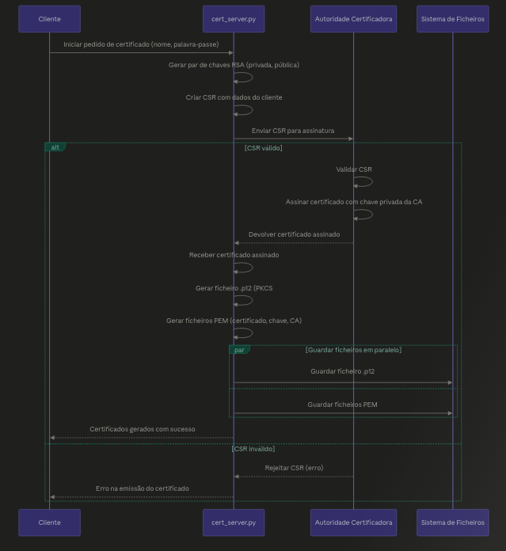

# Sistema de Conversação Seguro com E2EE

## Índice

1. [Introdução](#introdução)
2. [Arquitetura](#arquitetura)
3. [Identidade dos Intervenientes](#identidade-dos-intervenientes)
4. [Comunicação Cliente-Servidor](#comunicação-cliente-servidor)<br>
   i. [Handshake Autenticado](#handshake-autenticado)<br>
   ii. [Formato das Mensagens](#formato-das-mensagens)
5. [End-to-End Encryption](#end-to-end-encryption)<br>
   i. [Mensagens Privadas](#mensagens-privadas)<br>
   ii. [Mensagens Offline com Signed Prekeys](#mensagens-offline-com-signed-prekeys)<br>
   iii. [Sessões Online Efémeras](#sessões-online-efémeras)
6. [Contactos e Estado Protegido](#contactos-e-estado-protegido)
7. [Mensagens de Grupo](#mensagens-de-grupo)<br>
   i. [Criação e Distribuição da group_key](#criação-e-distribuição-da-group_key)<br>
   ii. [Rotação da group_key](#rotação-da-group_key)
8. [Comandos Suportados](#comandos-suportados)
9. [Funcionalidades Extra](#funcionalidades-extra)
10. [Modelo de Segurança](#modelo-de-segurança)
11. [Testes e Validação](#testes-e-validação)
12. [Limitações e Melhorias Futuras](#limitações-e-melhorias-futuras)
13. [Conclusão](#conclusão)

---

## Introdução

Este projeto tem como objetivo desenvolver um sistema de conversação seguro, em Python, que permita a troca de mensagens entre utilizadores com garantias de confidencialidade, integridade e autenticidade. A solução segue uma arquitetura cliente-servidor, onde o servidor é responsável por coordenar ligações, registar utilizadores, encaminhar mensagens e guardar informação persistente, mas sem conseguir ler o conteúdo das comunicações.

O modelo assumido é o de um servidor **honesto mas curioso**. Isto significa que o servidor executa corretamente as operações funcionais, mas não é considerado confiável para efeitos de confidencialidade. Por esse motivo, as mensagens são cifradas no cliente antes de serem enviadas, garantindo End-to-End Encryption (E2EE). Assim, mesmo quando uma mensagem é armazenada no servidor para entrega posterior, o servidor apenas guarda um envelope cifrado.

A solução utiliza a biblioteca `cryptography` e combina várias primitivas criptográficas: certificados X.509 para autenticação, X25519 para acordo de chaves, HKDF-SHA256 para derivação de chaves, AES-GCM para cifragem autenticada e RSA-PSS para assinaturas digitais. Para além dos requisitos base, foram implementadas valorizações como mensagens offline, signed prekeys, sessões online efémeras, grupos com chave simétrica própria, rotação de chaves de grupo e troca de mensagens por ficheiro num modelo semelhante a PGP.

---

## Arquitetura


A arquitetura do sistema é composta por três entidades principais: clientes, servidor e autoridade certificadora local. Cada utilizador executa uma instância do cliente, que é responsável pela interface textual, gestão local de chaves, cifragem e decifragem das mensagens, validação de assinaturas, gestão de contactos e processamento de grupos.

O servidor funciona como ponto central de coordenação. Este aceita ligações TCP, executa um handshake autenticado com cada cliente, processa comandos aplicacionais, mantém a lista de utilizadores online, encaminha mensagens em tempo real e armazena mensagens offline quando o destinatário não está ligado. Apesar deste papel central, o servidor não possui as chaves necessárias para decifrar o conteúdo das mensagens privadas ou de grupo.

A persistência é feita através de ficheiros JSON. O ficheiro `users.json` guarda informação pública dos utilizadores, como certificados, chaves públicas e signed prekeys públicas. O ficheiro `messages.json` guarda mensagens pendentes cifradas. Existem ainda ficheiros locais de contactos, grupos, bundles e chaves privadas, guardados no lado do cliente.

A implementação está organizada em módulos separados:

- `client/`: interface textual, estado local e handlers de comandos;
- `server/`: aceitação de ligações, validação de comandos, armazenamento e entrega de mensagens;
- `common/`: canal seguro, validação de certificados e troca de chaves cliente-servidor;
- `crypto/`: E2EE, signed prekeys, grupos, assinaturas, derivação de chaves e proteção de estado;
- `tools/`: ferramentas auxiliares, nomeadamente emissão de certificados de cliente;
- `tests/`: testes automatizados de segurança e funcionalidade.

Esta separação permite distinguir claramente a lógica de comunicação, a lógica de armazenamento e a lógica criptográfica. Em particular, o servidor apenas valida e encaminha envelopes, mas não executa operações de decifragem E2EE.

---

## Identidade dos Intervenientes

Cada interveniente do sistema possui uma identidade criptográfica baseada em certificados X.509 assinados por uma Autoridade Certificadora local. A CA local funciona como raiz de confiança do sistema. O servidor tem um certificado próprio, e cada cliente tem um certificado associado ao seu username.



No caso dos clientes, o certificado vincula o username à chave pública RSA de identidade. Durante o registo, o servidor não aceita simplesmente o username indicado pelo cliente: o username enviado no comando de registo tem de corresponder ao username extraído do certificado autenticado no handshake. Além disso, a chave pública RSA enviada pelo cliente tem de corresponder à chave pública presente no certificado.

Cada cliente mantém também uma chave E2EE X25519. Esta chave é usada como chave pública estática para receber mensagens no formato E2EE v2. Para impedir substituições maliciosas, a chave pública E2EE é assinada com a chave privada RSA de identidade do próprio utilizador. Assim, quando outro cliente recebe essa chave pública, consegue verificar que ela pertence ao utilizador autenticado.

A solução usa, portanto, dois tipos de chaves de longo prazo no cliente:

- **Chave RSA de identidade:** usada para autenticação, assinatura de mensagens, assinatura de signed prekeys e assinatura da chave pública E2EE;
- **Chave X25519 E2EE:** usada para derivar chaves simétricas de mensagem através de acordo de chaves.

A chave privada RSA e a chave privada X25519 ficam guardadas localmente no cliente. O servidor apenas recebe material público, como certificados, chaves públicas e signed prekeys públicas.

---

## Comunicação Cliente-Servidor

### Handshake Autenticado


Antes de qualquer comando aplicacional, cliente e servidor estabelecem um canal seguro. Este canal não substitui a E2EE entre clientes, mas protege a ligação de transporte contra ataques de rede, como escuta, modificação de mensagens ou man-in-the-middle.

O handshake segue os seguintes passos:

1. O cliente envia ao servidor o seu certificado X.509 e uma chave pública efémera X25519.
2. O servidor valida o certificado do cliente com o certificado da CA local.
3. O servidor extrai o username e a chave pública RSA do certificado do cliente.
4. O servidor gera a sua chave efémera X25519.
5. O servidor envia ao cliente o certificado do servidor, a sua chave pública efémera e uma assinatura sobre as chaves efémeras.
6. O cliente valida o certificado do servidor com a CA local.
7. O cliente verifica a assinatura do servidor, garantindo que a chave efémera recebida pertence ao servidor autenticado.
8. O cliente assina as chaves efémeras e envia a assinatura ao servidor.
9. O servidor verifica a assinatura do cliente usando a chave pública RSA presente no certificado do cliente.
10. Ambos calculam o segredo partilhado X25519.
11. O segredo partilhado é passado por HKDF-SHA256, gerando uma chave de sessão de 256 bits.
12. A partir desse momento, os frames JSON são cifrados com AES-GCM.

A assinatura das chaves efémeras é essencial para impedir ataques man-in-the-middle. Um atacante poderia tentar substituir as chaves X25519 durante a troca, mas não conseguiria produzir assinaturas válidas sem possuir as chaves privadas RSA das entidades autenticadas.

### Formato das Mensagens

A comunicação aplicacional entre cliente e servidor é feita através de objetos JSON. Antes do handshake, as mensagens necessárias para estabelecer o canal seguro são enviadas em claro. Depois do handshake, os objetos JSON são serializados, cifrados com AES-GCM e enviados dentro de um frame seguro.

Um frame seguro tem a seguinte estrutura simplificada:

```json
{
  "_secure": true,
  "data": "<payload_cifrado_em_base64>"
}
```

O campo `data` contém o resultado da cifragem AES-GCM do objeto JSON original. O nonce usado na cifragem é incluído no payload produzido pela função criptográfica. Como AES-GCM é uma cifra autenticada, qualquer alteração ao ciphertext ou à tag de autenticação causa falha na decifragem.

Os comandos enviados pelo cliente têm normalmente um campo `command`, por exemplo:

```json
{
  "command": "send_message",
  "message": {
    "type": "e2ee_message",
    "from": "alice",
    "to": "bob",
    "message_id": "...",
    "payload": {
      "nonce": "...",
      "ciphertext": "..."
    },
    "signature": "..."
  }
}
```

As respostas do servidor incluem normalmente um campo `status` e uma mensagem explicativa:

```json
{
  "status": "ok",
  "message": "mensagem processada"
}
```

Mesmo estando dentro de um canal seguro cliente-servidor, o conteúdo da mensagem E2EE continua cifrado a nível aplicacional. Isto significa que o servidor apenas vê o envelope necessário para encaminhamento e armazenamento, mas não o texto original.

---

## End-to-End Encryption

A E2EE é a camada principal de segurança do sistema. O objetivo é garantir que apenas o remetente e o destinatário conseguem aceder ao conteúdo das mensagens. O servidor pode encaminhar, guardar ou entregar envelopes, mas não consegue decifrar o texto das mensagens.

### Mensagens Privadas

As mensagens privadas são cifradas no cliente remetente e decifradas apenas no cliente destinatário. A implementação suporta dois formatos.

O formato legado v1 utiliza cifragem híbrida: gera uma chave AES aleatória para cifrar a mensagem com AES-GCM e cifra essa chave AES com RSA-OAEP usando a chave pública do destinatário. Este formato é mantido por compatibilidade.

O formato principal v2 usa X25519. O remetente gera uma chave efémera X25519, calcula um segredo partilhado com a chave pública E2EE X25519 do destinatário e deriva uma chave AES-256-GCM com HKDF-SHA256. A mensagem é então cifrada com essa chave. O destinatário usa a sua chave privada X25519 para obter o mesmo segredo partilhado e decifrar a mensagem.

Cada envelope de mensagem é assinado com a chave privada RSA de identidade do remetente. A assinatura permite ao destinatário confirmar que a mensagem foi criada pelo utilizador esperado e que o envelope não foi alterado. Para além disso, metadados como `message_id`, remetente, destinatário e timestamp são autenticados através de AAD no AES-GCM.

### Mensagens Offline com Signed Prekeys


Uma das valorizações implementadas é o suporte a mensagens offline. Quando um destinatário não está ligado, o servidor guarda a mensagem cifrada e entrega-a quando o destinatário voltar a fazer sincronização.

Para evitar depender exclusivamente da chave E2EE estática do destinatário, o sistema usa signed prekeys. Cada cliente publica no servidor um conjunto de signed prekeys públicas. Cada prekey é uma chave pública X25519 assinada com a chave RSA de identidade do utilizador. A respetiva chave privada fica apenas no cliente.

O fluxo de envio offline é o seguinte:

1. O destinatário publica signed prekeys públicas no servidor.
2. O remetente pede ao servidor uma signed prekey disponível do destinatário.
3. O servidor entrega uma prekey pública e marca-a como usada.
4. O remetente valida a assinatura da prekey.
5. O remetente gera uma chave efémera X25519.
6. O remetente deriva uma chave AES-GCM com X25519 + HKDF-SHA256.
7. A mensagem é cifrada e enviada ao servidor.
8. O servidor armazena apenas o envelope cifrado em `messages.json`.
9. Quando o destinatário fica online, descarrega a mensagem pendente.
10. O destinatário usa a chave privada da prekey correspondente para decifrar a mensagem.

Este mecanismo melhora a segurança das mensagens offline, porque cada mensagem pode ser associada a material de chave próprio. No entanto, a garantia depende da proteção e eliminação correta das chaves privadas das prekeys no cliente.

### Sessões Online Efémeras

Quando dois utilizadores estão online, o sistema tenta usar sessões E2EE efémeras. Neste modo, os dois clientes executam um pequeno handshake fim-a-fim com chaves X25519 efémeras. Esse handshake é assinado com as chaves RSA de identidade dos participantes.

Depois do handshake, ambos derivam uma `session_key` com HKDF-SHA256. Esta chave fica apenas em memória e é usada para cifrar mensagens online com AES-GCM. Cada mensagem inclui ainda um contador e metadados autenticados por AAD.

Este mecanismo oferece melhores garantias para conversas em tempo real, uma vez que a chave de sessão não corresponde diretamente à chave E2EE estática de longo prazo. Quando a sessão termina, a chave efémera é removida da memória.

---

## Contactos e Estado Protegido

O sistema permite manter uma lista local de contactos e conversas. Como esta informação também revela metadados sensíveis sobre os utilizadores, a solução protege os contactos antes de os armazenar no servidor.

A lista de contactos é normalizada, cifrada para o próprio utilizador e assinada com a chave privada RSA de identidade. O servidor apenas guarda o objeto protegido. Ao receber uma atualização, o servidor valida a assinatura, mas não consegue ler a lista de contactos.

O mesmo princípio é usado para o estado de grupos. A informação sensível, como nome do grupo, membros e chave de grupo, fica cifrada no estado protegido do cliente. O servidor apenas armazena o objeto cifrado e assinado, servindo como mecanismo de persistência.

Este modelo impede que o servidor altere silenciosamente contactos ou grupos, pois qualquer modificação invalida a assinatura. Também impede que o servidor leia diretamente a estrutura social completa de cada utilizador.

---

## Mensagens de Grupo

### Criação e Distribuição da group_key

A solução implementa mensagens de grupo através de uma chave simétrica partilhada por grupo. Quando um grupo é criado, o criador gera uma `group_key` aleatória de 256 bits. Esta chave é usada com AES-GCM para cifrar as mensagens do grupo.

A `group_key` nunca é enviada em claro ao servidor. Para distribuir a chave aos membros, o criador envia uma mensagem E2EE individual para cada membro do grupo. Dentro dessa mensagem cifrada segue a informação do grupo, incluindo o identificador do grupo, nome, lista de membros, versão da chave e a própria `group_key`.

As mensagens de grupo têm um envelope exterior mínimo, contendo apenas os campos necessários para encaminhamento e validação, como `group_id`, `from`, `to`, `message_id`, `timestamp`, `nonce`, `ciphertext` e `signature`. Informação sensível como nome do grupo, lista de membros e ações de controlo fica dentro do payload cifrado.

Desta forma, o servidor consegue encaminhar mensagens de grupo sem conhecer a composição completa do grupo nem a chave usada para cifrar as mensagens.

### Rotação da group_key

A rotação de chaves de grupo é necessária sempre que a composição do grupo muda. Se um membro for removido ou sair voluntariamente, esse utilizador não deve conseguir ler mensagens futuras.

Quando um membro é removido através de `group_kick`, a chave do grupo é rodada imediatamente. O novo valor da `group_key` é enviado apenas aos membros que continuam no grupo, usando mensagens E2EE individuais. O membro removido pode receber uma notificação de remoção, mas não recebe a nova chave.

Quando um membro sai voluntariamente com `group_leave`, os membros restantes elegem deterministicamente um líder de rotação. Esse líder gera uma nova `group_key` e distribui-a pelos membros restantes. Enquanto a rotação não termina, o grupo pode ficar em estado pendente para evitar envio de mensagens com uma chave antiga.

Este mecanismo garante confidencialidade futura relativamente a membros removidos, embora não apague o acesso que esses membros tiveram a mensagens antigas enquanto pertenciam ao grupo.

---

## Comandos Suportados

O cliente funciona como um interpretador de comandos textuais. A interface foi desenhada para permitir gerir contactos, conversas, grupos, sincronização e troca de mensagens por ficheiro.

### Comandos principais

#### `users`
Lista os utilizadores registados no servidor.

#### `contacts`
Lista os contactos locais do utilizador.

#### `add <user>`
Adiciona um utilizador aos contactos. A lista de contactos é atualizada localmente e sincronizada de forma protegida com o servidor.

#### `remove <user>`
Remove um utilizador dos contactos locais.

#### `chats`
Lista as conversas conhecidas pelo cliente.

#### `open <user|group_id>`
Abre uma conversa privada ou de grupo. Depois de aberta, o cliente entra em modo conversa e qualquer texto escrito é enviado como mensagem para o destino ativo.

#### `sync`
Sincroniza manualmente mensagens pendentes. Este comando é útil para descarregar mensagens offline armazenadas no servidor.

### Comandos de grupo

#### `groups`
Lista os grupos conhecidos localmente.

#### `group_create "<nome>" user1,user2`
Cria um grupo com o nome indicado e os membros especificados. O criador gera uma `group_key` e distribui-a aos membros através de mensagens E2EE individuais.

#### `group_remove <group_id>`
Remove um grupo do estado local do utilizador.

#### `group_kick <group_id> <user>`
Remove um membro de um grupo e força rotação da `group_key` para os membros restantes.

#### `group_leave <group_id>`
Permite ao utilizador sair de um grupo. Os restantes membros procedem à rotação da chave de grupo.

### Comandos por ficheiro

#### `export_bundle <ficheiro>`
Exporta um bundle público do utilizador para ficheiro. Este bundle contém o username, chave pública de identidade, chave pública E2EE, assinatura da chave E2EE e fingerprint.

#### `import_bundle <ficheiro>`
Importa o bundle público de outro utilizador. A importação valida a assinatura da chave E2EE e impede substituições silenciosas de chaves já conhecidas.

#### `export_msg <user> "<mensagem>" <ficheiro>`
Cria uma mensagem E2EE para um utilizador e guarda o envelope cifrado num ficheiro.

#### `import_msg <ficheiro>`
Importa uma mensagem cifrada de ficheiro e tenta processá-la localmente.

---

## Funcionalidades Extra

### Mensagens Offline

O servidor armazena mensagens cifradas quando o destinatário está offline. Estas mensagens são guardadas em `messages.json` e entregues quando o destinatário executa sincronização. A remoção definitiva das mensagens pendentes só acontece após confirmação de processamento através de ACK, evitando perda de mensagens em caso de falha do cliente.

### PKI Local

A solução inclui uma autoridade certificadora local, usada para assinar certificados do servidor e dos clientes. A validação de certificados é usada no handshake cliente-servidor e no registo de utilizadores. Existe ainda uma ferramenta administrativa para emissão de certificados de cliente.

### Signed Prekeys

Cada cliente pode publicar signed prekeys para permitir que outros utilizadores lhe enviem mensagens offline de forma mais segura. As prekeys públicas ficam no servidor, enquanto as respetivas chaves privadas permanecem apenas no cliente.

### Sessões Online Efémeras

Quando possível, dois clientes online estabelecem uma sessão efémera com X25519. As mensagens dessa sessão são cifradas com uma `session_key` temporária que fica apenas em memória.

### Mensagens de Grupo

Foram implementados grupos com `group_key` simétrica, cifragem AES-GCM, distribuição da chave via E2EE individual e rotação de chave quando a composição do grupo muda.

### Modo PGP-like por Ficheiro

A funcionalidade de exportação/importação de bundles e mensagens permite a troca assíncrona de mensagens cifradas por ficheiro, sem depender diretamente do servidor no momento da entrega.

---

## Modelo de Segurança

A solução considera três ameaças principais: atacantes de rede, servidor honesto mas curioso e utilizadores maliciosos.

Contra atacantes de rede, o canal cliente-servidor é protegido por handshake autenticado, certificados X.509, X25519, HKDF-SHA256 e AES-GCM. Isto impede leitura e modificação das mensagens de transporte e dificulta ataques man-in-the-middle.

Contra o servidor honesto mas curioso, a proteção principal é a E2EE. O servidor armazena e encaminha envelopes cifrados, mas não tem acesso às chaves privadas dos clientes, às chaves privadas das signed prekeys, às session keys online nem às group keys.

Contra utilizadores maliciosos, o sistema valida assinaturas, certificados, formatos de envelopes, metadados autenticados e permissões implícitas de grupo. Mensagens alteradas, chaves públicas sem assinatura válida ou envelopes com campos inválidos são rejeitados.

As principais garantias oferecidas são:

- **Confidencialidade:** mensagens privadas, offline e de grupo são cifradas antes de sair do cliente;
- **Integridade:** AES-GCM deteta alterações nos ciphertexts e metadados autenticados;
- **Autenticidade:** assinaturas RSA-PSS e certificados X.509 associam mensagens e chaves a identidades;
- **Proteção contra MitM:** o handshake assina chaves efémeras e valida certificados;
- **Confidencialidade offline:** mensagens pendentes são armazenadas cifradas no servidor;
- **Confidencialidade futura em grupos:** membros removidos deixam de receber a nova `group_key`.

Apesar destas garantias, a solução não pretende proteger contra compromisso local do dispositivo do utilizador. Se um atacante obtiver as chaves privadas locais, poderá comprometer a identidade do utilizador e decifrar informação acessível a esse cliente.

---

## Testes e Validação

A solução foi validada através da bateria de testes automatizados incluída no projeto. O comando usado foi:

```bash
python3 test_security.py
```

Os testes terminam com sucesso, indicando que os principais mecanismos implementados funcionam conforme esperado.

A bateria de testes cobre, entre outros aspetos:

- cifragem e decifragem AES-GCM;
- deteção de adulteração de ciphertext;
- validação de AAD;
- mensagens E2EE v1 e v2;
- assinatura e validação de envelopes;
- validação de certificados;
- associação entre username e certificado;
- signed prekeys;
- mensagens offline;
- entrega online sem armazenamento indevido;
- sincronização com ACK;
- sessões online efémeras;
- mensagens de grupo;
- rotação de `group_key`;
- proteção de contactos e grupos;
- importação/exportação de bundles;
- mensagens por ficheiro;
- concorrência no acesso a `users.json` e `messages.json`.

Este conjunto de testes não substitui uma prova formal de segurança, mas permite validar os principais fluxos funcionais e várias tentativas de adulteração relevantes para o modelo de ameaça considerado.

---

## Limitações e Melhorias Futuras

Apesar de a solução cumprir os objetivos principais, existem limitações importantes.

A primeira limitação é que o sistema não implementa um Double Ratchet completo. As sessões online usam chaves efémeras, mas não existe rotação de chave por mensagem como em protocolos modernos de comunicação segura.

Outra limitação é a proteção das chaves privadas locais. As chaves ficam guardadas em ficheiros locais e a solução não implementa ainda proteção forte por password com uma KDF adequada. Um atacante com acesso ao dispositivo do utilizador poderia comprometer essas chaves.

A PKI local também não implementa revogação de certificados. Se uma chave privada for comprometida, não existe ainda um mecanismo de CRL ou OCSP para invalidar certificados.

A privacidade de metadados é limitada. O servidor não vê o conteúdo das mensagens, mas continua a observar remetente, destinatário, timestamps, estado online/offline e padrões de comunicação. No caso dos grupos, o servidor observa o `group_id` exterior, embora não veja a `group_key`, nome do grupo ou lista completa de membros dentro do payload cifrado.

Como melhorias futuras, poderiam ser implementados:

- Double Ratchet para forward secrecy e post-compromise security mais fortes;
- proteção das chaves privadas locais com password e KDF;
- revogação de certificados;
- persistência local de histórico e mensagens já processadas;
- redução adicional de metadados visíveis ao servidor;
- confirmação de entrega fim-a-fim;
- política formal de administradores de grupo;
- interface gráfica;
- testes de integração com vários clientes reais em simultâneo.

---

## Conclusão

O sistema desenvolvido implementa um chat seguro com End-to-End Encryption, mantendo a arquitetura cliente-servidor pedida no enunciado, mas reduzindo a confiança colocada no servidor. O servidor continua a ser necessário para registo, encaminhamento, armazenamento offline e sincronização, mas não possui as chaves necessárias para ler o conteúdo das mensagens.

A solução combina PKI local, handshake autenticado, X25519, HKDF-SHA256, AES-GCM e RSA-PSS para fornecer confidencialidade, integridade e autenticidade. Foram também implementadas funcionalidades adicionais relevantes, como mensagens offline com signed prekeys, sessões online efémeras, grupos com `group_key`, rotação de chaves de grupo e troca de mensagens por ficheiro.

Embora ainda existam limitações, especialmente ao nível de forward secrecy completa, proteção local de chaves, revogação de certificados e privacidade de metadados, a solução apresenta uma arquitetura coerente e alinhada com os objetivos da unidade curricular. O projeto demonstra a aplicação prática de mecanismos criptográficos modernos na construção de um sistema de comunicação seguro.

